# God Hand Recompiled

> [!WARNING]
> **Work in progress. Tested through stage 2 and the start of stage 3.**
> Played so far (October 18, 2026): all of stage 1 and stage 2 with their bosses and cutscenes, and the first area
> of stage 3. Stage 3 onwards, the later bosses and the ending have not been played yet and may crash or misbehave.
> Expect bugs. Bug reports with the log (`build\port\bin\logs\play_last.log`) are welcome.

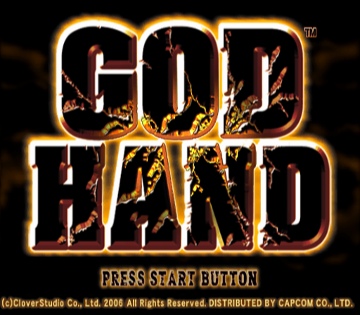

**A native PC port of God Hand (PS2, 2006) made by static recompilation. No emulator.**

God Hand was Clover Studio's last game and was only ever released on PS2. This project turns the game's own PS2 code
into a Windows program using [PS2Recomp](https://github.com/ran-j/PS2Recomp). You supply your own copy of the game.

## Status: work in progress, playable through stage 2

- **Tested: stages 1 and 2 and the first area of stage 3.** Fighting, bosses, dying and continuing, moving between
  areas, story cutscenes (including the sepia flashbacks), the Clover logo movie, the casino minigames, the God Reel,
  **saving and loading** all work in real play.
- **60 FPS at 3x resolution** (1536x1344, shown 4:3) on a modern GPU, cutscenes included. Windowed by default;
  F11 = full screen.
- **PC controls:** keyboard, mouse buttons and controllers, all rebindable in game. **The game's button prompts show
  the keys you bound** (for example ○ becomes "F"), switching to Xbox-style names when you play with a controller.
- **Not tested yet:** stage 3 onwards, the later bosses, the ending and its movies. All 81 of the game's code
  overlays are converted, but not all have been played yet.
- **First start:** the GPU shaders are built and cached on first use. The very first start can take a couple of
  minutes on a black screen, and new effects can pause the picture once for a moment the first time they appear.
  Later starts and scenes are cached.

**Fixes (October 18, 2026, later the same day):**
- Sound cutting out (5-11 ms gaps in music and voices, worst in stage 2 and the God Reel): the EE's SIF DMA status
  reported every transfer as still busy one frame too long, which starved the CRI ADX stream. Fixed.
- Grid of lines over the sepia flashback cutscenes and a thin line under movies at 3x: two GPU texture-sampling fixes
  that match the PS2's filtering exactly.
- The game could close while saving after about 30 minutes of play (a stack pool for game threads was never reused).
- Boss ○ CHECK freeze (stage 1): not seen again since the fixes, through two stages of play.
- Controls: Start/Select no longer reach the game during the Back+Start shortcut; Alt+Tab is no longer recorded as a
  binding; keys bound to two buttons are flagged on the F1 screen; the Windows Sticky Keys popup no longer appears
  while playing.
- Rare 3D geometry loss when the stage clipping program runs long, and a watchdog so the ending credits cannot hang
  if a movie stalls.

**Earlier fixes (October 18, 2026):**
- Boss ○ CHECK freeze, second cause: a "stop sound" request from the game could interrupt the CRI sound mixer
  mid-mix. Like on a PS2, such requests now wait until no higher-priority sound thread is ready.
- Slow cutscenes (15-30 FPS): some cutscenes use VU1 microprograms that were not compiled ahead of time. The port now
  logs each one and saves it to `build\port\bin\logs\vu1_missing\`, ready for the VU1 step below.
- Save states (F5/F9) remember the sound driver's protected sections, and after F9 the memory card is re-read
  instead of written through stale data.
- Controls: Caps Lock / Num Lock bindings follow the key, not the keyboard light; Back+Start while rebinding a
  controller button cancels; an unreadable `controls.ini` is reported on the F1 screen.
- The launcher keeps the previous session's log as `logs\play_<time>.log`.

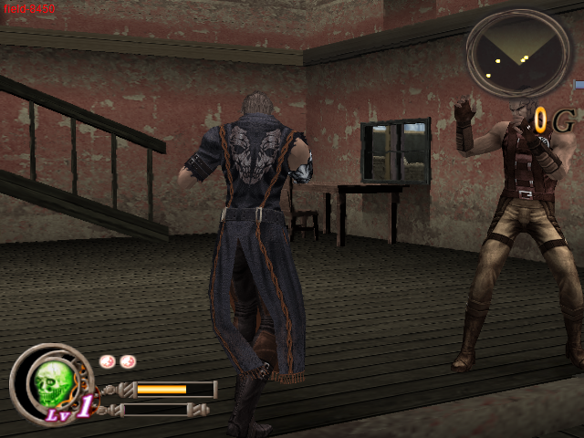

## Screenshots

All captured from this port running natively on PC.

| | |
|---|---|
| 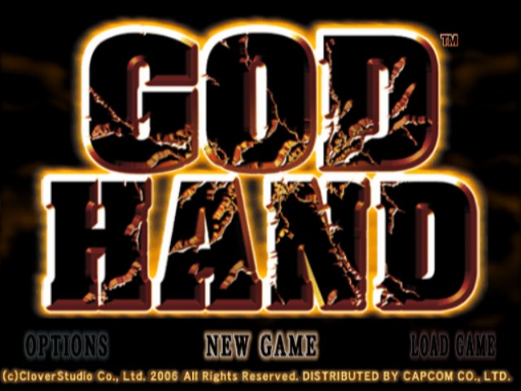 | 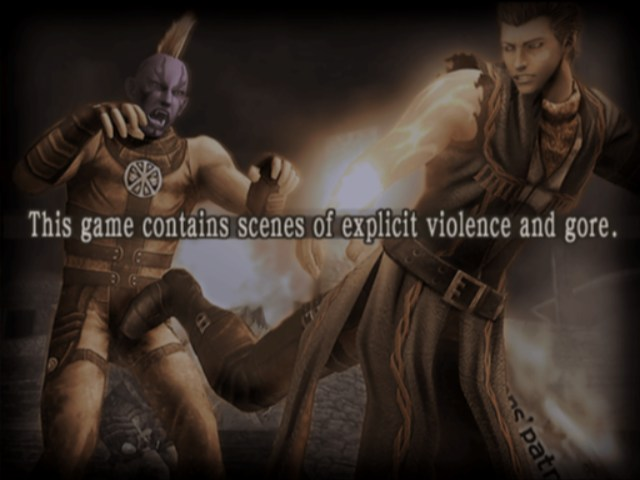 |
| Title menu | Opening warning screen |
| 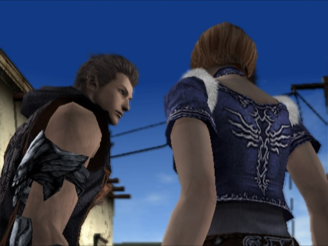 | 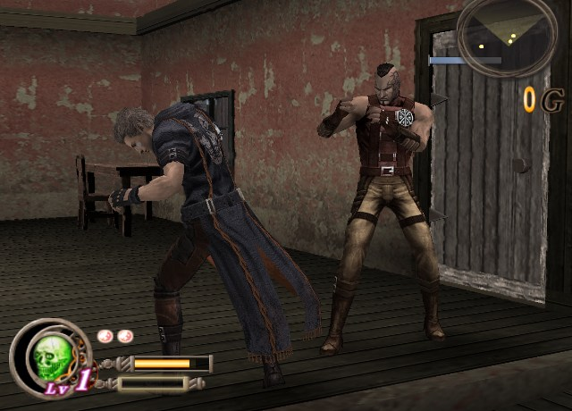 |
| Opening cutscene | Fighting inside the saloon |

**At 3x internal resolution (1536x1344):**

| | |
|---|---|
| 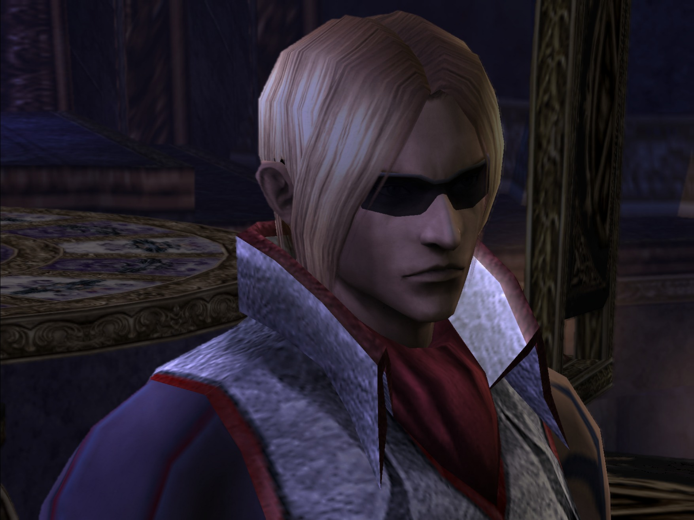 | 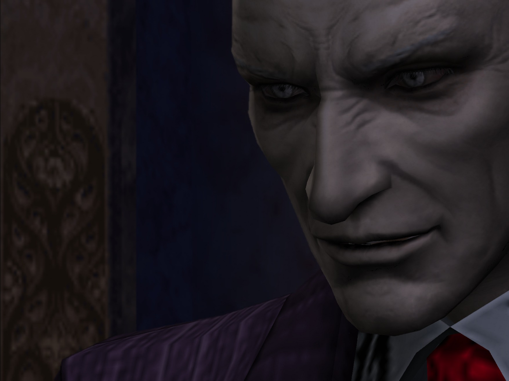 |

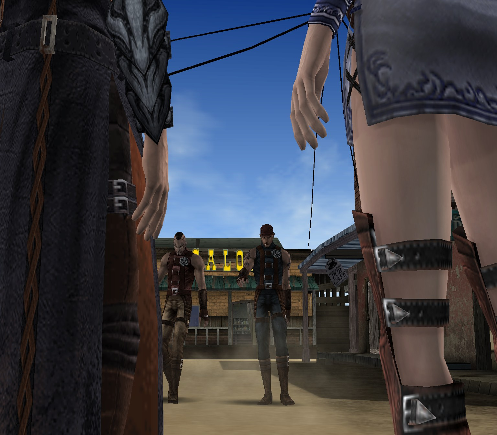

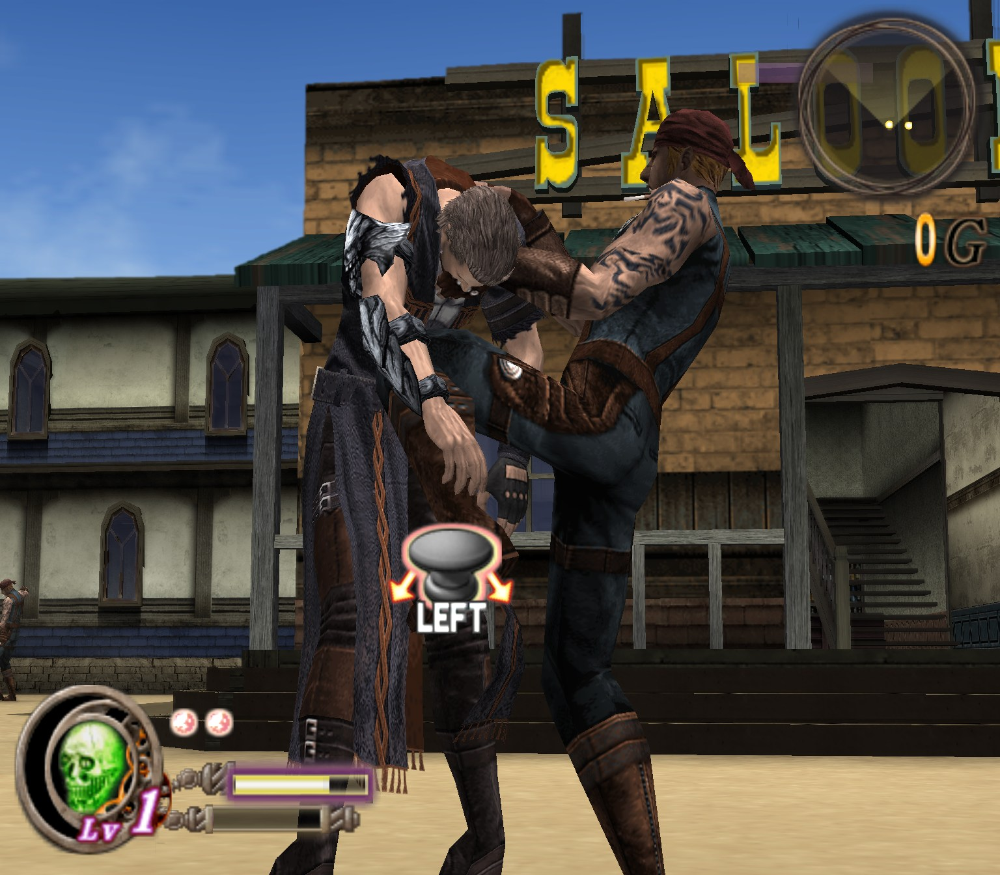

## Controls

Press **F1** in game (or **Back + Start** on a controller) to change any key or button.
Each row shows what the action does. Changes save to `controls.ini` and work right away.

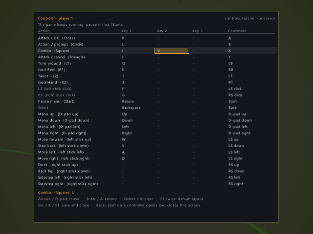

| Action | Keyboard | Controller |
|--------|----------|------------|
| Move / step back | W A S D | Left stick |
| Duck / back flip / sidestep | (unbound, set with F1) | Right stick |
| Attack / OK | K | A |
| Action / prompt | L | B |
| Combo | J | X |
| Attack / cancel | I | Y |
| Turn around / God Reel | Q / E | LB / RB |
| Taunt / God Hand | 1 / 3 | LT / RT |
| Pause menu / Select | Enter / Backspace | Start / Back |
| Menus | Arrow keys | D-pad |

F12 opens the runtime debugger. To quit, close the window.

## Build and run

You need Windows 10/11, Visual Studio 2022 (or Build Tools) with C++ (CMake and Ninja come with it), Python 3.10+, and
your own legally owned copy of God Hand (USA, SLUS-21503). Check your disc image against [DISC_HASHES.md](DISC_HASHES.md):
the game's boot file must match, or the port refuses to start.

```powershell
git clone https://github.com/LasVola/godhand-recomp.git
cd godhand-recomp
copy "D:\path\to\God Hand (USA).iso" game\
python -I build.py generate                                   # recompile the main program from your disc
python -I tools\snr2\snr2.py extract --iso "game\God Hand (USA).iso"
python -I tools\snr2\gen_modules.py                           # the 81 code overlays (rooms, events, memory card)
python -I build.py modules
python -I build.py build                                      # downloads raylib/imgui on the first configure
```

Run it with `Start-God-Hand.cmd` (or `python -I build.py run`). The log of the last session is
`build\port\bin\logs\play_last.log`.

For full speed in 3D, compile the VU1 microprograms ahead of time:
1. Play once with `PS2X_VU1_CAPTURE=<folder>` set. Any program met later that is still not compiled is also saved to
   `build\port\bin\logs\vu1_missing\` (and logged as `[vu1-aot] image ... has no compiled code`): copy those
   `vu1_*.bin` files into the same folder.
2. Build `vu1_recomp` (`python -I build.py configure -DGODHAND_BUILD_TOOLS=ON`, then
   `python -I build.py build vu1_recomp`).
3. Run `build\port\runtime\ps2xTest\vu1_recomp.exe <folder> generated\vu1`, then rebuild.

Without this, VU1 is interpreted and 3D scenes and cutscenes run slower. The stage 1 played so far uses 8 programs.

These are the steps the author runs. A build from a completely fresh clone has not been verified yet.

## How it works

- **The main program** (`SLUS_215.03`) is recompiled to C++. Function boundaries come from the
  [god-hand-decomp](https://github.com/LucasPicoli/god-hand-decomp) symbol list plus the PS2 SDK entry points.
- **The overlays.** God Hand loads 81 relocatable code DLLs (SNR2 `.rel`: rooms, events, memory card) from
  `_DATA.AFS` while you play.
  - `tools/snr2` relocates each one exactly like the game's loader does, then recompiles it.
  - The game layer (`src/godhand/function_hooks.cpp`) gives every DLL type a fixed memory slot.
  - It installs the matching recompiled code when the game links the DLL.
- **Runtime fixes made for this game:**
  - SIF DMA status, IOP stack ownership, IOP module arguments, sysclib ctype;
  - VIF1 split-image uploads, GS colour interpolation (the "speckle" fix), VU1 recompiler loads;
  - SIF RPC servers, audio time-stretch default, the in-game Controls screen.

  Each change is commented where it is made.

## Credits and legal

- [PS2Recomp](https://github.com/ran-j/PS2Recomp) by ran-j and contributors: the recompiler and runtime.
- [LightVelox](https://github.com/LightVelox): the [sotc-port runtime fork](https://github.com/LightVelox/PS2Recomp) and
  [Shadow of the Colossus port](https://github.com/LightVelox/sotc-vibe-pc).
- [thiagordsfx](https://github.com/thiagordsfx): the [Urban Reign port](https://github.com/thiagordsfx/urban-reign-recomp).
  Its runtime, VU1 compiler, SPU2 and PCSX2 GS bridge are the base of this port.
- [PCSX2](https://github.com/PCSX2/pcsx2): GS code in `thirdparty/`.
- [Ace Combat 5 static recompilation](https://github.com/sal063/Ace-Combat-5-Static-recompilation): the IPU (movie)
  decoder (Apache-2.0).
- [LucasPicoli/god-hand-decomp](https://github.com/LucasPicoli/god-hand-decomp): function names and boundaries.
- This port: built with AI assistance (Claude Code by Anthropic, with OpenAI Codex as a reviewer), directed and
  play-tested by LasVola (October 2026).

The code here is GPL-3.0 licensed ([LICENSE](LICENSE)), like PS2Recomp. Third-party licenses are in `docs/licenses/`
and the `thirdparty/` folders. **No game data is included**; you must use your own copy.
**God Hand** is a trademark of Capcom. This project is not affiliated with Capcom or Clover Studio.

**Let's keep God Hand alive.**
